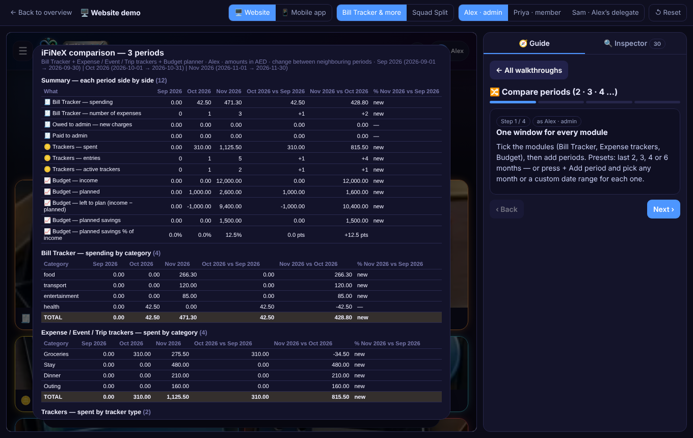
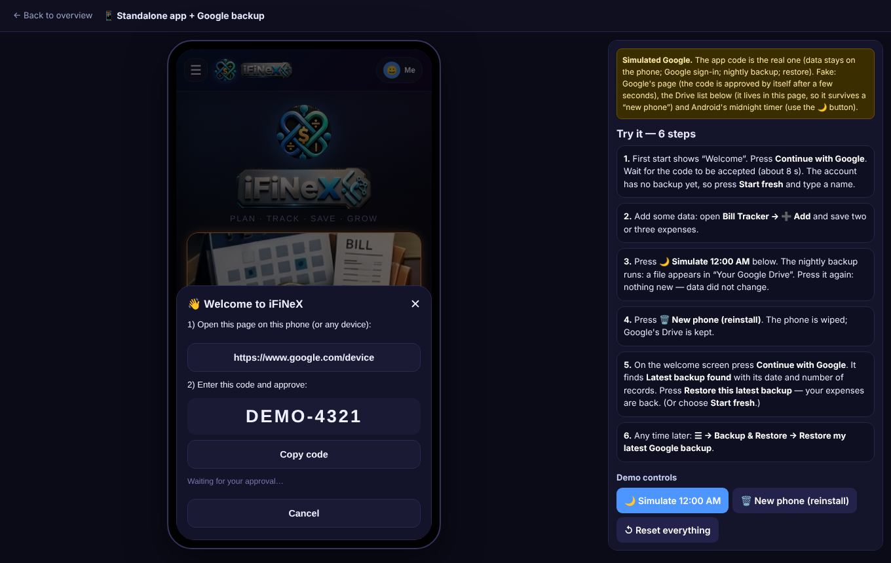

# iFiNeX

**Plan · Track · Save · Grow** — bills, cards, shared expenses, trackers and budgets in one app.

[**Live demo**](https://squadsplit.github.io/iFiNeX-Demo/) · [Website](https://squadsplit.github.io) · [Android app](https://github.com/SquadSplit/iFiNeX-Mobile) · [Privacy](https://squadsplit.github.io/privacy.html) · [Terms](https://squadsplit.github.io/terms.html)

## ▶ Try it now — live demo, no sign-up

<a href="https://squadsplit.github.io/iFiNeX-Demo/"><b>▶ Open the live demo</b></a> &nbsp;·&nbsp;
<a href="https://squadsplit.github.io/iFiNeX-Demo/play.html?device=web&user=alex">🖥️ Website as admin</a> &nbsp;·&nbsp;
<a href="https://squadsplit.github.io/iFiNeX-Demo/play.html?device=mobile">📱 Mobile app</a> &nbsp;·&nbsp;
<a href="https://squadsplit.github.io/iFiNeX-Demo/play.html?scenario=reports">📊 Statements &amp; reports</a> &nbsp;·&nbsp;
<a href="https://squadsplit.github.io/iFiNeX-Demo/play.html?scenario=compare">🔀 Compare periods</a> &nbsp;·&nbsp;
<a href="https://squadsplit.github.io/iFiNeX-Demo/standalone.html">☁️ Standalone + Google backup</a>

GitHub does not allow a running app inside a README (scripts and iframes are removed), so the animation above is a recording and every link opens the **real interactive demo** on GitHub Pages — the same way the repo's *Website* link in the right-hand sidebar does.

The first screen lets you choose:

| Option | What you get |
|---|---|
| 🖥️ **Website** | The full web app on a desktop-size screen (you are *Alex*, the admin) |
| 📱 **Mobile app** | The Android app experience in a phone frame (you are *Priya*, a member) |
| ↔ **Both at once** | Website and phone side by side with a realtime activity feed |

It is more than a preview — it is a complete guide to the app:

- **21 guided walkthroughs** (spend, cards, party ledger, admin, delegate access, plans, trips, budget, squads, import/export, backup, Google Drive, statements & reports, **period comparison, tracker clone, category sets**, themes…)
- **Request Inspector** — see every database call the app makes and why the database allows it
- **Searchable guide to every option and function** (82 entries) and a **database explorer** (34 tables)
- Roles table, key flows, and honest limits

Everything uses fictional people and fake data and runs only in your browser. Nothing is stored or sent anywhere, and reloading resets it.

### New in v14.0 — try each one in the demo

| | What | Demo |
|---|---|---|
| 🔀 | **Compare 2 · 3 · 4 … periods** (months or custom dates) for Bill Tracker, Expense trackers and Budget — PDF · Excel · CSV | [Compare periods](https://squadsplit.github.io/iFiNeX-Demo/play.html?scenario=compare) |
| 📑 | **Clone** an expense tracker or a budget month for next month (asks name + duration) | [Clone](https://squadsplit.github.io/iFiNeX-Demo/play.html?scenario=clone) |
| 🏷️ | **Categories per tracker type** — Mess = meals only, Groceries = no meals, 11 sets | [Categories](https://squadsplit.github.io/iFiNeX-Demo/play.html?scenario=cats) |
| ☁️ | **Standalone app**: sign in with Google, **nightly 12:00 AM backup**, restore the latest backup on a new phone | [Standalone demo](https://squadsplit.github.io/iFiNeX-Demo/standalone.html) |

## What is inside

- **Bill Tracker** — cards, payees, plans, reminders, who owes whom
- **Expense Tracker** — monthly, events, trips and custom types
- **Squad Split** — several squads, each with its own people, expenses and settlements
- **Budget & Salary Planner** — income, budget lines, savings goals
- **Backup & Restore** — file export/import and optional Google Drive scheduled backup
- **Android app** — same app, with alerts and in-app updates

## Run your own

The code is open for self-hosting (website on GitHub Pages, database on Supabase). See the setup guides in the open-source repository.

## What's new in v14.0 (web 14.0 / app 7.0.0 / database v10.0)

* **Comparison reports** — 2, 3, 4 … periods side by side (months or custom dates) for Bill Tracker, Expense / Event / Trip trackers and the Budget planner; download PDF, Excel (Summary + one sheet per section) or CSV.
* **Clone** an expense tracker (name + duration, optionally with entries) and a budget month.
* **Category sets per tracker type** (Mess = meals only, Groceries = no meals, …) — stored in `et_trackers.categories` / `cat_set` (run the v10.0 SQL once).
* **Standalone**: Google sign-in on first start (restore the latest backup or start fresh), **nightly 12:00 AM backup** to the user's own Google Drive (Android job works with the app closed), "Restore my latest Google backup" any time.
* **Supabase disk-IO**: `poll_notifications` now writes `last_seen_at` at most every 6 h (was every poll); Android polls every 5 min instead of 2.
* **GitHub build fix**: regenerated `package-lock.json` and an `npm ci` → `npm install` fallback in the workflow.

## What's new in v13.1 (demo / README only — web 13.0 and app 6.0.0 unchanged)
* README now opens with an animated recording of the live demo and one-click links (website, mobile, statements). Fixed the screenshots, which pointed to a folder that was missing.
* Demo screenshots re-recorded from v13.0, including the new Statements & reports window.

## What's new in v13.0 (web 13.0 / app 6.0.0) — choose who, direction and report type
* **With whom:** pick Everyone or tick specific people (e.g. only Kaatuva, or Kaatuva + Naina) for the statement of the chosen account(s).
* **Direction:** tick "what they owe the account" and/or "what the account owes them".
* **Report type is now two checkboxes:** Balances and/or Full breakdown (breakdown alone is allowed).
* **Grand total is clearer:** "TOTAL OWED TO <you>" and "TOTAL <you> OWES" are separate lines; the NET only appears when both exist. Example: others owe Abdullah 3,898.43 — it is no longer silently reduced by what he owes someone else.
* Mobile layout: long TOTAL labels span the table instead of wrapping in one narrow cell.

## What's new in v12.2 (web 12.2 / app 5.1.1) — correct, readable statement
* **Squad Split now matches the Squad page** (all expenses + carried balances − settlements, then the same "simplify" netting). Before, the report only looked inside single months and showed 0 for someone who owes 547.
* **Who pays whom:** one column per person ("To pay Abdullah", "To pay Naina" …), one row per module, TOTAL TO PAY.
* **One block per person**, months **newest first** (opening + new charges − paid = closing), ending with "X NEEDS TO PAY Y — TOTAL"; the **GRAND TOTAL is always the last table**.
* Full breakdown: every entry newest first with a running balance; a "Squad netting" line explains the difference to a one-to-one ledger.
* PDF: no more broken characters (arrows / minus), bold headings, right-aligned numbers.

## What's new in v12.1 (web 12.1 / app 5.1.0) — Play Protect fix
* The GitHub workflow built a **debug** APK (`assembleDebug`, debuggable=true) and published it. Google Play Protect treats debuggable, side-loaded APKs that can install other APKs as high risk ("Harmful app blocked"). The workflow now builds `assembleRelease` (debuggable=false) signed with the SAME permanent key, so updates still install over the old app.
* `build.gradle` release type: `debuggable false`, uses the iFiNeX key (fallback: debug key only when no key exists).

## What's new in v12.0 (app 5.0.0)
**Statements that say who pays whom** — every module now has its own 📊 report button (Bill Tracker, Party ledger, Squad Split, EPP & Gold plans, Shared card payments, Expense / Event / Trip trackers, Budget planner) and the Hub has the all-modules one. One simple window: **1 Duration** (Weekly · Monthly · All time · Custom) · **2 Modules** (tick boxes) · **3 Users** · **4 Report type**. *Balances only* = TOTAL TO PAY per person (Squad Split + Bill Tracker + EPP & Gold together), OWED TO YOU, Paid so far (to whom, how much, when) and a month-by-month balance (brought forward + new charges − paid = closing). *Full breakdown* adds every share, settlement, carried-forward balance, party entry, instalment, spending line and card due. Output: preview · PDF · Excel · CSV. Read-only, no database change. Supabase "disk IO budget" e-mail investigated: the database is idle (18 MB, ~1 checkpoint buffer per run); see the reference file section W.

